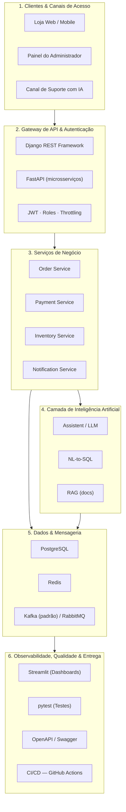

# SynapseShop — Backend de Pedidos com Inteligência Artificial


> Projeto desenvolvido no contexto da **SynapseTech** — empresa simulada do curso de
> **Programação Python Avançada com IA** (100 horas · 25 aulas).

---

## 1. Sobre o Projeto

O **SynapseShop** é o backend de uma loja online voltado à gestão de produtos, pedidos,
pagamentos simulados e notificações. Sobre essa base transacional robusta, opera uma camada
inteligente responsável por três pilares de IA:

1. **Assistente de Suporte (`/assist`)** — responde dúvidas de clientes sobre pedidos e status
   usando um serviço de IA resiliente (com *retry* e *circuit breaker*).
2. **Consulta em Linguagem Natural (`/ask_sql`)** — converte perguntas em texto corrido
   (ex.: *"quais os produtos mais vendidos este mês?"*) em consultas SQL dinâmicas.
3. **Assistente de Documentação via RAG (`/ask_docs`)** — responde com base no próprio `README`
   e na documentação técnica da API, com citação rigorosa das fontes.

O desenvolvimento segue a metodologia **SpecDD (Specification-Driven Development)**, de forma
incremental, a partir das especificações registradas em [`specs/`](specs/).

---

## 2. Equipe

| Papel | Atribuições |
| :--- | :--- |
| **Tech Lead & Product Owner** | Conduz a formação do time, define o domínio do projeto e garante o entendimento unificado da arquitetura-alvo. |
| **DevOps / SRE** | Cria e configura o repositório no GitHub, garantindo acesso e permissão de contribuição a todos os membros. |
| **Arquiteto(a)** | Planeja a arquitetura em camadas e a estrutura inicial da documentação. |
| **Desenvolvedor(a)** | Implementa o código do MVP em camadas lógicas (API, Serviços e Repositórios). |
| **Especialista em IA** | Desenha e integra os serviços de IA (assistente, texto-para-SQL e RAG). |

### Integrantes

1. Alan Correa
2. Amanda Gomes
3. Alvaro Luiz
4. Gustavo Lima
5. Ricardo Reis
6. Hiram Simoes
7. Caio Barbosa

---

## 3. Domínio da Loja

**Eletrônicos** — e-commerce de produtos eletrônicos (categorias, catálogo e gestão de pedidos),
mantendo aderência total aos requisitos técnicos obrigatórios do MVP.

---

## 4. MVP — Descrição

Backend containerizado de uma loja de **eletrônicos** com gestão de produtos, pedidos, pagamentos
simulados e notificações, exposto por APIs (Django REST Framework + FastAPI) com autenticação JWT
baseada em papéis. O MVP integra, na camada de IA, pelo menos uma das funcionalidades inteligentes
(assistente de suporte, texto-para-SQL ou RAG) e opera com mensageria assíncrona, cache e testes
automatizados.

**Critérios de conclusão (DoD global):**
- Subir o ambiente completo com um único comando: `docker-compose up`.
- Autenticação JWT com pelo menos dois papéis de usuário.
- Fluxo ponta a ponta `Pedido ➔ Pagamento ➔ Notificação` com mensageria, idempotência e DLQ.
- Testes automatizados dentro da meta da turma e documentação OpenAPI/Swagger.
- Pelo menos uma funcionalidade de IA operacional.
- Pipeline de CI/CD (GitHub Actions) e dashboard analítico (Streamlit).
- Documentação completa em Markdown, incluindo o histórico de prompts em [`PROMPTS.md`](PROMPTS.md).

---

## 5. Arquitetura-Alvo em 6 Camadas

O sistema é projetado em **6 camadas lógicas**, conteinerizadas via Docker e orquestradas com
Docker Compose:



### Descrição textual das camadas

1. **Clientes & Canais de Acesso** — Loja Web/Mobile, Painel do Administrador e Canal de Suporte com IA.
2. **Gateway de API & Autenticação** — DRF para a API principal, FastAPI para microsserviços; JWT com papéis (roles) e *throttling*.
3. **Serviços de Negócio** — *Order Service* (criação e eventos), *Payment Service* (pagamento simulado), *Inventory Service* (estoque/produtos) e *Notification Service* (consumidor de eventos).
4. **Camada de IA** — Assistente de suporte, consultas NL-to-SQL e RAG, integrados a provedores de LLM externos (OpenAI/DeepSeek).
5. **Dados & Mensageria** — PostgreSQL (relacional + migrações Alembic), Redis (cache-aside), Kafka (eventos, idempotência e DLQ) com RabbitMQ como broker alternativo.
6. **Observabilidade, Qualidade & Entrega** — Dashboards Streamlit, testes `pytest`, OpenAPI/Swagger e CI/CD com GitHub Actions.

---

## 6. Definição de Pronto — Aula 1 (Kick-off)

- [x] Repositório único do projeto criado no GitHub.
- [x] Todos os membros do time com permissão de escrita/push (colaboradores definidos na spec).
- [x] `README.md` na raiz com equipe, papéis, domínio e arquitetura-alvo em 6 camadas.
- [x] `PROMPTS.md` criado na raiz para registro do histórico de uso de IA generativa.

---

## 7. Infraestrutura (Aula 3) — Docker Compose

O ambiente é orquestrado com Docker Compose e sobe com **um único comando**:

```bash
docker-compose up
```

### Serviços

| Serviço | Imagem | Porta | Objetivo |
| :--- | :--- | :--- | :--- |
| `api` | `synapseshop:dev` (build local) | `8000` | Executa a aplicação e expõe a rota de monitoramento `/health`. |
| `inventory` | `synapseshop-inventory:dev` (build local) | `8100` | Microsserviço de estoque em FastAPI (Aulas 5–6), com `/docs` e persistência em PostgreSQL via Alembic. |
| `pedido-worker` | `synapseshop:dev` (build local) | — | Consumidor da Camada 5 (Aulas 9–10). Escalável com `--scale`. |
| `postgres` | `postgres:16-alpine` | `5432` | Banco de dados relacional do MVP (dados persistidos). |
| `redis` | `redis:7-alpine` | `6379` | Cache-aside do catálogo, deduplicação e contadores de métricas, com política `allkeys-lru` e volume `redisdata`. |
| `kafka` | `apache/kafka:3.9.1` | `9092` / `29092` | Broker de eventos (KRaft single-node, Aula 10). `9092` para o host, `29092` para a rede Compose. |
| `rabbitmq` | `rabbitmq:3-management` | `5672` / `15672` | Broker alternativo (Aula 9), com UI de gerenciamento. |

O serviço `api` recebe via variáveis de ambiente as credenciais do banco
(`POSTGRES_HOST`, `POSTGRES_PORT`, `POSTGRES_DB`, `POSTGRES_USER`, `POSTGRES_PASSWORD`)
e conecta no serviço `postgres` pelo hostname interno `postgres`, aguardando o
`service_healthy` antes de subir. Dados do banco são persistidos no volume `pgdata`.

Desde a **Aula 8** a API também depende do serviço `redis` (`REDIS_URL`,
`CACHE_ENABLED`, `CACHE_TTL_LISTA`, `CACHE_TTL_DETALHE`), aguardando o
`service_healthy` do Redis. Se o Redis ficar indisponível, a API continua
respondendo a partir do PostgreSQL (`IGNORE_EXCEPTIONS=True`) e o header
`X-Cache` passa a reportar `BYPASS`.

Desde a **Aula 9** a API e o `pedido-worker` publicam e consomem eventos. Desde a
**Aula 10** o broker padrão é o serviço `kafka` (KRaft, sem ZooKeeper), com
`service_healthy` antes de qualquer consumidor subir. Os dois brokers ficam de pé
no Compose; qual está ativo é a variável `MENSAGERIA_BROKER`.

### Procedimentos

- **Subir o ambiente:** `docker-compose up` (ou `docker-compose up --build -d` em modo *detached*)
- **Derrubar o ambiente:** `docker-compose down` (adicione `-v` para apagar também o volume `pgdata`)
- **Acompanhar os logs:** `docker-compose logs -f`
- **Logs de um serviço específico:** `docker-compose logs -f api` ou `docker-compose logs -f postgres`
- **Verificar a saúde da API:** `curl http://localhost:8000/health` → `{"status": "ok"}`
- **Status dos serviços:** `docker-compose ps`

A imagem utiliza **multistage build** (`builder` gera as dependências; `runtime` mantém a
imagem final enxuta), executa com **usuário não-root** e gerencia o **cache de dependências**
copiando o `requirements.txt` antes do código. No start, o contêiner aplica as migrações
(`python manage.py migrate`), cria os usuários demo para autenticação
(`python manage.py seed_demo_users`, Aula 7) e sobe o servidor de desenvolvimento do Django
na porta `8000`.

---

## 8. API Principal (Aula 4) — Django REST Framework

A API principal é construída com **Django 5.2 LTS** + **Django REST Framework 3.18**, com
operações CRUD completas sob rotas versionadas em `/api/v1/`. Desde a **Aula 7** o banco é o
**PostgreSQL** do Compose (driver `psycopg` 3), o mesmo do microsserviço `inventory` e com
persistência no volume `pgdata`. Nas Aulas 4–6 a API operava sobre SQLite, escopo agora
superado.

> **A partir da Aula 7,** todos os endpoints de `/api/v1/` exigem autenticação JWT
> (leitura) e os endpoints de escrita exigem o papel `admin` — ver a
> [Seção 9](#9-autenticação-jwt-papéis-e-throttling-aula-7).

### Estrutura

| Caminho | Camada | Responsabilidade |
| :--- | :--- | :--- |
| `config/` | Projeto | `settings.py`, `urls.py`, `wsgi.py`/`asgi.py`. |
| `repositories/` | Dados | App Django com os models `User` (papéis Aula 7), `Category` e `Item`. |
| `api/` | API | Serializers, ViewSets, roteador e a view `/health`. |
| `services/` | Negócio | Reservado para regras de domínio (aulas futuras). |

### Endpoints

| Método | Rota | Ação | Status |
| :--- | :--- | :--- | :--- |
| GET | `/api/v1/categories/` | Lista categorias | 200 / 401 |
| POST | `/api/v1/categories/` | Cria categoria (admin) | 201 / 400 / 401 / 403 |
| GET | `/api/v1/categories/{id}/` | Detalha categoria | 200 / 404 / 401 |
| PUT/PATCH | `/api/v1/categories/{id}/` | Atualiza categoria (admin) | 200 / 400 / 401 / 403 / 404 |
| DELETE | `/api/v1/categories/{id}/` | Remove categoria (admin) | 204 / 401 / 403 / 404 |
| GET | `/api/v1/items/` | Lista itens | 200 / 401 |
| POST | `/api/v1/items/` | Cria item (admin) | 201 / 400 / 401 / 403 |
| GET | `/api/v1/items/{id}/` | Detalha item | 200 / 404 / 401 |
| PUT/PATCH | `/api/v1/items/{id}/` | Atualiza item (admin) | 200 / 400 / 401 / 403 / 404 |
| DELETE | `/api/v1/items/{id}/` | Remove item (admin) | 204 / 401 / 403 / 404 |
| GET | `/health` | Monitoramento | 200 |

O `Item` possui `name`, `description`, `price` (`Decimal`), `category` (FK) e `is_active`;
o `Category` possui `name` (único), `description` e `created_at`.

### Migrações e execução

```bash
docker-compose up --build          # aplica as migrações e sobe a API
docker-compose exec api python manage.py makemigrations   # novas migrações
docker-compose exec api python manage.py migrate          # aplicar manualmente
```

### Exemplos rápidos

```bash
curl http://localhost:8000/health

curl -X POST http://localhost:8000/api/v1/categories/ \
  -H "Content-Type: application/json" \
  -d '{"name": "Eletronicos", "description": "Produtos eletronicos"}'

curl -X POST http://localhost:8000/api/v1/items/ \
  -H "Content-Type: application/json" \
  -d '{"name": "Notebook", "price": "4999.90", "category": 1}'
```

A coleção consolidada de rotas está em
[`docs/postman/SynapseShop.postman_collection.json`](docs/postman/SynapseShop.postman_collection.json)
para importação no Postman, e o guia de revisão de código gerado por IA está em
[`docs/CHECKLIST_IA_SAFE.md`](docs/CHECKLIST_IA_SAFE.md).

---

## 9. Autenticação JWT, Papéis e Throttling (Aula 7)

A camada de acesso seguro da API principal usa **JWT stateless** (Bearer) com **dois
papéis** (`admin` e `user`), **throttling** contra força bruta e **paginação/filtros**
nos endpoints críticos. Tudo configurável via variáveis de ambiente
(`JWT_*`, `THROTTLE_*`, `SEED_*` — ver [Seção 14](#14-variáveis-de-ambiente)).

### Usuários e papéis

O modelo de usuário é customizado (`repositories.User`, sobre `AbstractUser`) e persistido
em **PostgreSQL**, na tabela `repositories_user` do mesmo banco do `inventory`. O
comando `python manage.py seed_demo_users` — executado no start do container — cria,
de forma idempotente, dois usuários demo a partir das envs `SEED_*`:

| Usuário | Papel | Credenciais default |
| :--- | :--- | :--- |
| `admin` | `admin` (acesso total) | `admin` / `admin` |
| `user` | `user` (somente leitura) | `user` / `user` |

### Fluxos de autenticação

| Método | Rota | Ação | Status |
| :--- | :--- | :--- | :--- |
| POST | `/api/v1/auth/token/` | Login → `{access, refresh, role}` | 200 / 401 / 429 |
| POST | `/api/v1/auth/token/refresh/` | Renova o access token | 200 / 401 / 429 |

O token (access e refresh) carrega a claim `role`, permitindo ao cliente controlar a
interface sem chamadas extras. Defaults: access 60 min, refresh 7 dias.

### Proteção das rotas administrativas

- **Leitura** (`GET` list/detail) de `/api/v1/categories/` e `/api/v1/items/`: exige
  **autenticação** (qualquer papel) → sem token retorna **401**.
- **Escrita** (`POST`/`PUT`/`PATCH`/`DELETE`): exige o papel **`admin`** → usuário comum
  autenticado retorna **403**.
- `/health` permanece **público** (monitoramento).

### Throttling e segurança mínima

| Escopo | Onde se aplica | Default |
| :--- | :--- | :--- |
| `anon` | endpoints DRF sem autenticação | `20/min` |
| `user` | endpoints DRF autenticados | `200/min` |
| `login` | `POST /api/v1/auth/token/*` (anti força bruta) | `5/min` |

Exaurida a taxa de `login`, o servidor responde **429 Too Many Requests** antes mesmo de
validar credenciais.

### Paginação e filtros nos endpoints críticos

- Paginação por **página numerada**: `{count, next, previous, results}` com
  `page_size` default de **10** e ajuste via `?page_size=`.
- **Busca** (`?search=`), **ordenação** (`?ordering=`) e filtros por **query param**:
  `is_active`, `category` em `/api/v1/items/`.

### Exemplos rápidos

```bash
# Login admin (guarde o access token)
curl -X POST http://localhost:8000/api/v1/auth/token/ \
  -H "Content-Type: application/json" \
  -d '{"username": "admin", "password": "admin"}'

# Rotas protegidas: leitura exige Bearer
curl http://localhost:8000/api/v1/categories/ \
  -H "Authorization: Bearer <access_token>"

# Escrita exige papel admin; usuário comum recebe 403
curl -X POST http://localhost:8000/api/v1/categories/ \
  -H "Authorization: Bearer <access_token>" \
  -H "Content-Type: application/json" \
  -d '{"name": "Eletronicos", "description": "Produtos eletronicos"}'

# Paginação e filtros nos itens
curl "http://localhost:8000/api/v1/items/?search=Notebook&is_active=true&page_size=5" \
  -H "Authorization: Bearer <access_token>"
```

Decisões em
[`docs/DECISOES_TECNICAS_AULA7.md`](docs/DECISOES_TECNICAS_AULA7.md); as
evidências numéricas foram arquivadas em
[`docs/historico/METRICAS_AULA7.md`](docs/historico/METRICAS_AULA7.md), e os
cenários estão na
[coleção consolidada do Postman](docs/postman/SynapseShop.postman_collection.json).

---

## 10. Microsserviço de Inventário — FastAPI (Aulas 5 e 6)

Microsserviço complementar de estoque (`inventory`) construído com **FastAPI**,
conteinerizado separadamente e orquestrado pelo mesmo `docker-compose`. Desde a
**Aula 6** o estado é persistido no **PostgreSQL** com mapeamento via
**SQLAlchemy 2.0** e **migrações versionadas com Alembic** (a autenticação JWT
fica na Aula 7 — escopo SpecDD preservado).

> **Serviço independente:** `inventory` tem imagem, dependências, migrações e
> banco lógicos próprios — o Django não o importa nem compartilha código. Ele
> permanece no Compose (e fora do contexto de build da API, via
> `.dockerignore`) porque a integração entre os dois é por HTTP, não por
> código; desligá-lo não derruba a API principal, apenas remove as rotas de
> estoque.

### Estrutura

| Caminho | Responsabilidade |
| :--- | :--- |
| `inventory/app/main.py` | Aplicação FastAPI, `/health` e raiz com informações do serviço. |
| `inventory/app/schemas.py` | Modelos Pydantic (contratos de entrada, saída e validações). |
| `inventory/app/db.py` | SQLAlchemy: `engine`, `Base`, `SessionLocal` e dependency `get_session()`. |
| `inventory/app/models.py` | Modelo ORM `InventoryItem` (índices essenciais e integridade). |
| `inventory/app/repository.py` | `InventoryRepository` — persistência transacional (commit/rollback). |
| `inventory/app/services.py` | `InventoryService` — regras de domínio sobre o repositório. |
| `inventory/app/routes.py` | Rotas do inventário sob `/inventory/items`. |
| `inventory/migrations/` | Migrações Alembic (`versions/0001_create_inventory_items.py`). |
| `inventory/scripts/` | Smoke test e teste transacional com coleta de tempos. |
| `inventory/Dockerfile` | Imagem com multistage build e usuário não-root (porta `8100`). |

### Endpoints

| Método | Rota | Ação | Status |
| :--- | :--- | :--- | :--- |
| GET | `/health` | Monitoramento | 200 |
| GET | `/inventory/items` | Lista itens de estoque | 200 |
| POST | `/inventory/items` | Cria item de estoque | 201 / 400 / 409 |
| GET | `/inventory/items/{id}/` | Detalha item | 200 / 404 |
| PATCH | `/inventory/items/{id}/` | Atualiza item | 200 / 404 / 409 |
| PATCH | `/inventory/items/{id}/stock` | Ajusta estoque (transação) | 200 / 404 / 409 |
| DELETE | `/inventory/items/{id}/` | Remove item | 204 / 404 |

A **documentação automática (OpenAPI/Swagger)** está disponível em
`http://localhost:8100/docs`.

### Migrações de schema (Alembic + PostgreSQL)

Aplicadas automaticamente no start do contêiner (`alembic upgrade head`).
Manualmente, dentro do contêiner:

```bash
docker compose exec inventory alembic current          # revisão corrente
docker compose exec inventory alembic history          # histórico de revisões
docker compose exec inventory alembic upgrade head     # aplica pendentes
docker compose exec inventory alembic downgrade -1     # rollback de 1 revisão
```

O modelo relacional (`inventory_items`) contempla índices essenciais
(`sku` único e `name`) e integridade relacional (`NOT NULL`, `sku` único e
`CheckConstraint quantity >= 0`). Detalhes em
[`docs/historico/DECISOES_TECNICAS_AULA6.md`](docs/historico/DECISOES_TECNICAS_AULA6.md)
e métricas em
[`docs/historico/METRICAS_AULA6.md`](docs/historico/METRICAS_AULA6.md).

### Exemplos rápidos

```bash
curl http://localhost:8100/health
curl http://localhost:8100/docs

curl -X POST http://localhost:8100/inventory/items \
  -H "Content-Type: application/json" \
  -d '{"sku": "NB-001", "name": "Notebook 16GB", "quantity": 10}'

curl http://localhost:8100/inventory/items
curl http://localhost:8100/inventory/items/1

# Ajuste transacional de estoque
curl -X PATCH http://localhost:8100/inventory/items/1/stock \
  -H "Content-Type: application/json" \
  -d '{"delta": -2}'
```

O padrão de prompts de IA da squad está definido em
[`PROMPTS-TEMPLATE.md`](PROMPTS-TEMPLATE.md), com registro no
[`PROMPTS.md`](PROMPTS.md).

---

## 11. Cache-aside com Redis (Aula 8)

O catálogo passou a ser servido por **cache-aside com Redis** (`django-redis`),
com TTL, invalidação por eventos de domínio, header `X-Cache` e métricas de hit
rate. O microsserviço `inventory` permanece intocado.

### Estrutura

| Caminho | Responsabilidade |
| :--- | :--- |
| `services/cache.py` | Cache-aside, assinatura de chaves, TTL, índices de invalidação, métricas e logs. |
| `services/events.py` | Dispatcher in-process de eventos de domínio (`emitir`/`registrar`). |
| `services/cache_invalidation.py` | Ligação evento do domínio → chaves de cache a invalidar. |
| `api/views.py` | Cache nos endpoints de itens e `CacheStatsView`. |
| `api/apps.py` | `ready()` registra os handlers de invalidação. |
| `repositories/management/commands/seed_demo_catalog.py` | Catálogo de 5 categorias e 300 itens para medição. |
| `scripts/bench_cache.py` | Benchmark de latência (média, p50, p95) e RPS. |
| `scripts/smoke_test_cache.py` | Verificação de miss/hit, TTL, invalidação e métricas. |

### Chaves e TTL

| Chave Redis (após `KEY_PREFIX`) | Conteúdo | TTL |
| :--- | :--- | ---: |
| `synapseshop:1:itens:list:<assinatura>` | página da listagem já paginada | 60 s |
| `synapseshop:1:item:<id>` | item único já serializado | 300 s |
| `itens:list:indice` / `itens:detalhe:indice` | *sets* de chaves ativas, para invalidação | — |

A listagem é cacheada por **assinatura**: SHA-1 de 12 caracteres dos query params
relevantes (`search`, `ordering`, `category`, `is_active`, `min_price`,
`max_price`, `page`, `page_size`) ordenados e normalizados, para que filtros
diferentes nunca compartilhem a mesma chave.

### Estratégia de invalidação

A invalidação é orientada a **eventos de domínio**, não a tempo. Cada escrita
emite um evento **após o commit** no PostgreSQL (`transaction.on_commit`), e o
handler apaga as chaves afetadas:

| Evento | Invalida |
| :--- | :--- |
| `ItemCriado` / `ItemAtualizado` / `ItemRemovido` | `item:<id>` e todas as `itens:list:*` |
| `CategoryCriada` / `CategoryAtualizada` / `CategoryRemovida` | `item:<id>` e todas as `itens:list:*` |

Pontos-chave da estratégia:

- **`on_commit`:** sem ele, um rollback invalidaria o cache com o dado ainda no
  banco, produzindo uma leitura inconsistente.
- **Índice em *set*:** as chaves de listagem são registradas em
  `itens:list:indice`, então a invalidação faz 1 `SMEMBERS` + `DEL` do conjunto,
  sem `SCAN` nem `KEYS` sobre o keyspace.
- **Falha isolada:** handler com `try/except` — evento de domínio nunca derruba
  a requisição de escrita. Se o handler falhar, o log registra `handler_falhou`
  e o TTL assume como rede de segurança.
- **Sem broker:** dispatcher in-process, conforme a restrição SpecDD (Kafka e
  RabbitMQ são das aulas 9-11). `emitir()` é o ponto de extensão futuro.

### Endpoints de métricas

| Método | Rota | Ação | Acesso |
| :--- | :--- | :--- | :--- |
| GET | `/api/v1/cache/stats/` | Hit rate por endpoint e global | admin |
| POST | `/api/v1/cache/stats/` | Zera os contadores | admin |

```json
{
  "cache_habilitado": true,
  "endpoints": {
    "itens:list":  {"hits": 40, "misses": 1, "total_lookups": 41, "hit_rate": 0.9756, "ttl_segundos": 60},
    "item:detalhe": {"hits": 25, "misses": 1, "total_lookups": 26, "hit_rate": 0.9615, "ttl_segundos": 300}
  },
  "total_hits": 65, "total_misses": 2, "total_lookups": 67, "hit_rate": 0.9701
}
```

### Observabilidade

Header `X-Cache` em toda resposta de item: `HIT`, `MISS` ou `BYPASS` (cache
desativado). Logs estruturados JSON:

```json
{"evento": "cache.lookup", "endpoint": "itens:list", "chave": "itens:list:c846376af757", "resultado": "MISS", "ttl": 60, "origem": "postgresql"}
{"evento": "dominio.emitido", "nome": "ItemAtualizado", "payload": {"item_id": 110}}
```

### Desempenho medido

Catálogo de 300 itens, par A/B na **mesma imagem** alternando apenas
`CACHE_ENABLED`, 150 requisições com concorrência 1: a listagem cai de 22,01 ms
para **15,48 ms** (−29,7 %) e o detalhe de 24,08 ms para **17,07 ms** (−29,1 %),
com RPS +42,1 % e +41,0 % respectivamente.

Ciclo de vida observado em tempo real: `MISS` → `HIT` → (60 s) `MISS` por
expiração de TTL, e `HIT` → `MISS` logo após um `PATCH`, por evento de domínio.
A decomposição do custo por requisição e as ressalvas de variância estão em
[`docs/METRICAS_AULA8.md`](docs/METRICAS_AULA8.md); as decisões e alternativas
consideradas em [`docs/DECISOES_TECNICAS_AULA8.md`](docs/DECISOES_TECNICAS_AULA8.md).

### Exemplos rápidos

```bash
# Popula o catálogo de medição (idempotente)
docker compose exec -T api python manage.py seed_demo_catalog

# Ciclo miss -> hit na listagem (X-Cache na resposta)
curl -i "http://localhost:8000/api/v1/items/?page_size=10" -H "Authorization: Bearer <access_token>"
curl -i "http://localhost:8000/api/v1/items/?page_size=10" -H "Authorization: Bearer <access_token>"

# Invalidação: o PATCH invalida item:<id> e todas as listas
curl -X PATCH "http://localhost:8000/api/v1/items/110/" \
  -H "Authorization: Bearer <access_token>" -H "Content-Type: application/json" \
  -d '{"name":"Item alterado"}'
curl -i "http://localhost:8000/api/v1/items/110/" -H "Authorization: Bearer <access_token>"

# Métricas de hit rate (admin)
curl -X POST "http://localhost:8000/api/v1/cache/stats/" -H "Authorization: Bearer <access_token>"
curl "http://localhost:8000/api/v1/cache/stats/" -H "Authorization: Bearer <access_token>"

# Chaves e TTL no Redis
docker compose exec -T redis redis-cli -n 1 --scan --pattern 'synapseshop:1:*'
docker compose exec -T redis redis-cli -n 1 SMEMBERS "itens:list:indice"
docker compose exec -T redis redis-cli -n 1 TTL "synapseshop:1:item:110"

# Benchmark (antes/despues, o --path vai no caminho da listagem ou do detalhe)
python scripts/bench_cache.py --path "/api/v1/items/?page_size=10" --requests 150 --concurrency 1

# Kill-switch: desliga o cache sem mexer no código (X-Cache passa a BYPASS)
# CACHE_ENABLED=false docker compose up -d --force-recreate api

# Verificação funcional
python scripts/smoke_test_cache.py
```

### Operação

| Comandos | Efeito |
| :--- | :--- |
| `docker compose exec -T redis redis-cli -n 1 FLUSHALL` | Limpa cache e contadores |
| `docker compose exec -T redis redis-cli -n 1 INFO memory` | Memória usada pelo Redis |
| `docker compose logs -f api` | Logs estruturados `cache.lookup` e `dominio.emitido` |

Quando `CACHE_ENABLED=false`, o backend passa a `LocMemCache` e o header
`X-Cache` responde `BYPASS` — a API segue funcionando, sem cache.

> **Nota:** com o cache no Redis, os contadores do throttling do DRF (Aula 7)
> passaram a viver no Redis. Ganho de consistência entre workers, com a
> consequência de que o estado sobrevive a reinícios até expirar a janela.

---

## 12. Mensageria Assíncrona — Kafka (Camada 5)

O fluxo de pedidos é assíncrono: a API grava o pedido e publica o evento
`PedidoCriado` num broker; um *worker* dedicado consome a fila, processa a
mensagem e persiste o estado no repositório. Reentregas são tratadas por
**idempotência**, recuo exponencial e, em último caso, **Dead Letter Queue**.

O broker padrão é o **Kafka** (Aula 10). O **RabbitMQ** da Aula 9 continua
funcionando atrás da mesma fachada — a escolha de broker é uma variável de
ambiente, e ambos passam no mesmo smoke test.

### Kafka ou RabbitMQ

| Critério | Kafka (padrão) | RabbitMQ (alternativo) |
| :--- | :--- | :--- |
| Paralelismo de consumo | por partição do tópico | por consumidor da fila |
| Retenção | nativa, por tópico | limitada a filas duráveis |
| Rota de falha | tópico DLQ explícito | *dead-letter exchange* da fila |
| Ordem | por partição (chave = `idempotency_key`) | por fila (*round-robin*) |

O contrato em `events/contracts.py` traz `event_type` e `version`, então a troca
de broker não quebra o formato da mensagem. O RabbitMQ ficou sob o perfil
`rabbitmq` do Compose — para usá-lo: `MENSAGERIA_BROKER=rabbitmq docker compose
--profile rabbitmq up -d`.

### Endpoints

| Método | Rota | Ação | Status |
| :--- | :--- | :--- | :--- |
| POST | `/api/v1/pedidos/` | Cria pedido e publica `PedidoCriado` | 201 / 200 / 400 / 401 |
| GET | `/api/v1/pedidos/{id}/` | Detalha pedido (dono ou admin) | 200 / 404 |

A criação exige autenticação (qualquer papel) — diferentemente do catálogo, em
que escrita é `admin`-only, porque o pedido pertence a quem o cria. `201` traz
`evento_publicado: true`; se o broker recusar o evento, a resposta é `202` com
`evento_publicado: false` (dado commitado, falha em log).

### Exemplos rápidos

```bash
# Token e criação do pedido (o evento é publicado no mesmo passo)
TOKEN=$(curl -s -X POST http://localhost:8000/api/v1/auth/token/ \
  -H "Content-Type: application/json" -d '{"username":"user","password":"user"}' \
  | python -c "import sys,json;print(json.load(sys.stdin)['access'])")

curl -X POST http://localhost:8000/api/v1/pedidos/ \
  -H "Authorization: Bearer $TOKEN" -H "Content-Type: application/json" \
  -d '{"idempotency_key":"pedido-2026-0001","itens":[{"item_id":1,"quantidade":2}]}'

# O worker leva o pedido de PENDENTE para PROCESSANDO
curl http://localhost:8000/api/v1/pedidos/15/ -H "Authorization: Bearer $TOKEN"

# Logs de produtor e consumidor / estado dos tópicos do Kafka
docker compose logs -f api pedido-worker
docker compose exec -T kafka /opt/kafka/bin/kafka-topics.sh --bootstrap-server localhost:29092 --list
```

### Operação

| Comando | Efeito |
| :--- | :--- |
| `PEDIDO_WORKER_FALHA_IDEM_KEYS="pedido-dlq-*" docker compose up -d --force-recreate pedido-worker` | Simula erro para validar reentrega/DLQ |
| `MENSAGERIA_BROKER=rabbitmq docker compose --profile rabbitmq up -d --force-recreate api pedido-worker` | Alterna para o broker da Aula 9 |
| `docker compose up -d --scale pedido-worker=3 pedido-worker` | Escala o consumo (1 consumidor por partição) |
| `MESSAGERIA_ENABLED=false docker compose up -d --force-recreate api` | Kill-switch: grava o pedido sem publicar (202) |

### Verificação e desempenho

O smoke test (`python scripts/smoke_test_mensageria.py`) cobre os dois brokers:
publicação, contrato, consumo com persistência, idempotência (produtor e
reentrega) e chegada à DLQ — **25 PASS / 0 FAIL** no Kafka, **23 PASS / 0 FAIL**
no RabbitMQ. O benchmark (`scripts/bench_mensageria.py`) mede latência ponta a
ponta e drenagem de backlog; números, ambiente e limites em
[`docs/METRICAS_AULA10.md`](docs/METRICAS_AULA10.md).

### Documentação completa

Topologia, contrato da mensagem, idempotência, reentrega/recuo/DLQ,
estrutura de módulos, observabilidade e operação detalhada em
[`docs/GUIA_MENSAGERIA.md`](docs/GUIA_MENSAGERIA.md). As decisões de projeto em
[`docs/DECISOES_TECNICAS_AULA10.md`](docs/DECISOES_TECNICAS_AULA10.md).


---

## 13. Testes Automatizados (Aula 12)

Suíte `pytest` organizada em `tests/unit` (ramos felizes e de erro, parametrizados)
e `tests/integration` (ciclo de vida completo dos recursos na API), com cobertura
global mínima de **85%** (.coveragerc). A execução atual mede **98,1%** do código
aplicacional de `services`, `events`, `api`, `config`, `repositories` e `workers`.

### Execução

```bash
python -m pytest                       # suíte completa (unit + integration)
python -m pytest tests/unit            # somente unitários
python -m pytest tests/integration     # somente integração
pytest --cov --cov-report=term-missing # relatório detalhado linha a linha
```

No PowerShell, os atalhos de `tasks.ps1` cobrem o dia a dia: `.\tasks.ps1 test`,
`.\tasks.ps1 openapi`, `.\tasks.ps1 check`, `.\tasks.ps1 smoke` e
`.\tasks.ps1 mensageria` (sem argumento, lista tudo).

O `pytest.ini` já define `DJANGO_SETTINGS_MODULE=config.settings_test`
(`config/settings_test.py`): SQLite em memória, `LocMemCache` (`CACHE_ENABLED=True`),
`MESSAGERIA_ENABLED=False`, hashers MD5 e throttle elevado — a suíte evita
dependências externas (PostgreSQL, Redis, broker). No container, a mesma suíte
roda com `docker-compose exec api pytest --cov`.

### O que a suíte prova

| Camada | Cobertura |
| :--- | :--- |
| `events/contracts.py` · `events/topology.py` | Contratos: serialização, validação e topologia — 100%. |
| `services/cache.py` · `services/cache_invalidation.py` | Cache-aside com `FakeRedis`, TTL, invalidação por eventos, métricas e falhas do Redis — 100%. |
| `services/events.py` · `services/idempotencia.py` | Dispatcher in-process e deduplicação com falha de Redis caindo no PostgreSQL. |
| `services/pagamento.py` · `services/notificacao.py` | Pedido ➔ Pagamento ➔ Notificação: idempotência, corridas e publicação — 100%. |
| `services/health.py` · `services/publicacao.py` · `services/messaging.py` | Healthchecks (PostgreSQL/Redis/broker) e fachada de transporte (kafka/rabbitmq/rejeição). |
| `api/*` | Serializers (validações), permissões, filtros, paginação, auth JWT e cache stats — 99–100%. |
| `repositories/models.py` · seeds | Models e comandos `seed_demo_users` / `seed_demo_catalog` — 100%. |

As barras e o estado realista aparecem com `--cov term-missing`; a meta de
85% é imposta por `[report] fail_under` no `.coveragerc`.

### Escopo da medição

A cobertura mede o código de aplicação. Ficam de fora, de propósito
(documentado em `.coveragerc`): migrações, `__init__`, `config/settings*.py`,
pontas WSGI/ASGI e os **transportes de broker**
(`services/messaging_kafka.py`, `services/messaging_rabbit.py`), que exigem um
broker real no ar e por isso são exercitados pelo smoke test do Compose (Aula 10).

---

## 14. Variáveis de ambiente

A configuração dos serviços é feita por variáveis de ambiente. O `docker-compose.yml`
interpola essas variáveis (`${VAR}`) a partir do arquivo `.env` da raiz do projeto e injeta
os valores nos contêineres. Para começar:

```bash
cp .env.example .env
```

O `.env` **não é versionado** (ver `.gitignore`/`.dockerignore`); o `.env.example` é o
modelo versionado com todas as variáveis. Todos os valores têm default em `:-` no compose,
então o ambiente também sobe sem `.env` (com os valores de dev).

| Variável | Default | Consumida por |
| :--- | :--- | :--- |
| `DJANGO_SECRET_KEY` | `dev-insecure-synapseshop-change-me` | `api` (`config/settings.py`) |
| `DJANGO_DEBUG` | `true` | `api` (`config/settings.py`) |
| `JWT_ACCESS_TOKEN_MINUTES` | `60` | `api` (`config/settings.py` — lifetime do access JWT) |
| `JWT_REFRESH_TOKEN_DAYS` | `7` | `api` (`config/settings.py` — lifetime do refresh JWT) |
| `THROTTLE_ANON` | `20/min` | `api` (`config/settings.py` — throttling de não autenticados) |
| `THROTTLE_USER` | `200/min` | `api` (`config/settings.py` — throttling de autenticados) |
| `THROTTLE_LOGIN` | `5/min` | `api` (`config/settings.py` — throttling do login/token) |
| `REDIS_URL` | `redis://redis:6379/1` (Compose) · `redis://localhost:6379/1` (código) | `api` (`config/settings.py` — cache e throttling) |
| `CACHE_ENABLED` | `true` | `api` (`config/settings.py` — kill-switch do cache-aside) |
| `CACHE_TTL_LISTA` | `60` | `api` (`config/settings.py` — TTL da listagem em segundos) |
| `CACHE_TTL_DETALHE` | `300` | `api` (`config/settings.py` — TTL do detalhe em segundos) |
| `CACHE_TTL_PEDIDO` | `60` | `api`, `pedido-worker`, `notificacao-worker` (`config/settings.py` — TTL do detalhe do pedido, Aula 11) |
| `RABBITMQ_HOST` | `rabbitmq` (Compose) · `localhost` (código) | `api`, `pedido-worker`, `notificacao-worker` |
| `RABBITMQ_PORT` | `5672` | `api`, `pedido-worker` |
| `RABBITMQ_USER` / `RABBITMQ_PASSWORD` | `guest` / `guest` | `api`, `pedido-worker` |
| `RABBITMQ_VHOST` | `/` | `api`, `pedido-worker` |
| `MENSAGERIA_BROKER` | `kafka` | `api`, `pedido-worker`, `notificacao-worker` — broker ativo (`kafka` ou `rabbitmq`) |
| `MENSAGERIA_ENABLED` | `true` | `api` (`config/settings.py` — kill-switch da publicação) |
| `KAFKA_BOOTSTRAP_SERVERS` | `localhost:9092` (código) · `kafka:29092` (Compose) | `api`, `pedido-worker`, scripts |
| `KAFKA_TOPICO_PEDIDO_CRIADO` | `pedidos.pedidocriado` | `api`, `pedido-worker` |
| `KAFKA_TOPICO_PEDIDO_CRIADO_DLQ` | `pedidos.pedidocriado.dlq` | `api`, `pedido-worker` |
| `KAFKA_TOPICO_PAGAMENTO_PROCESSADO` | `pagamentos.pagamentoprocessado` | `api`, `notificacao-worker` (Aula 11) |
| `KAFKA_TOPICO_PAGAMENTO_PROCESSADO_DLQ` | `pagamentos.pagamentoprocessado.dlq` | `api`, `notificacao-worker` (Aula 11) |
| `KAFKA_TOPICO_NOTIFICACAO_ENVIADA` | `notificacoes.notificacaoenviada` | `api`, `notificacao-worker` (Aula 11) |
| `KAFKA_TOPICO_NOTIFICACAO_ENVIADA_DLQ` | `notificacoes.notificacaoenviada.dlq` | `api`, `notificacao-worker` (Aula 11) |
| `KAFKA_GRUPO_NOTIFICACAO` | `notificacao-worker` | `notificacao-worker` (Aula 11) |
| `KAFKA_PARTICOES` | `3` | `api`, `pedido-worker`, `notificacao-worker` (paralelismo de consumo) |
| `KAFKA_REPLICAS` | `1` | `api`, `pedido-worker` (1 = broker único) |
| `KAFKA_RETENTION_MS` | `604800000` (7 dias) | `api`, `pedido-worker` |
| `KAFKA_CLEANUP_POLICY` | `delete` | `api`, `pedido-worker` |
| `KAFKA_GRUPO_CONSUMIDORES` | `pedido-worker` | `pedido-worker` |
| `KAFKA_AUTO_OFFSET_RESET` | `earliest` | `pedido-worker` |
| `KAFKA_PRODUCER_ACKS` | `all` | `api`, `pedido-worker` |
| `KAFKA_PRODUCER_LINGER_MS` | `5` | `api`, `pedido-worker` |
| `KAFKA_POLL_TIMEOUT_S` | `1.0` | `pedido-worker` |
| `KAFKA_SESSION_TIMEOUT_MS` | `10000` | `pedido-worker` |
| `KAFKA_MAX_POLL_INTERVAL_MS` | `300000` | `pedido-worker` |
| `IDEMPOTENCIA_TTL_SEGUNDOS` | `86400` | `api`, `pedido-worker` (janela de deduplicação) |
| `MENSAGERIA_MAX_RETRIES` | `3` | `pedido-worker` (reentregas além da 1ª tentativa) |
| `MENSAGERIA_BACKOFF_BASE_MS` | `250` | `pedido-worker` (base do recuo exponencial) |
| `MENSAGERIA_BACKOFF_MAX_MS` | `5000` | `pedido-worker` (teto do recuo) |
| `RABBITMQ_PREFETCH` | `1` | `pedido-worker` (mensagens em voo por consumidor) |
| `RABBITMQ_FILA_PAGAMENTO_PROCESSADO` / `RABBITMQ_FILA_PAGAMENTO_PROCESSADO_DLQ` | `pagamentos.pagamentoprocessado` / `pagamentos.pagamentoprocessado.dlq` | `api`, `notificacao-worker` (Aula 11) |
| `RABBITMQ_FILA_NOTIFICACAO_ENVIADA` / `RABBITMQ_FILA_NOTIFICACAO_ENVIADA_DLQ` | `notificacoes.notificacaoenviada` / `notificacoes.notificacaoenviada.dlq` | `api`, `notificacao-worker` (Aula 11) |
| `RABBITMQ_ROUTING_KEY_PAGAMENTO_PROCESSADO` | `pagamento.processado` | `api`, `notificacao-worker` (Aula 11) |
| `RABBITMQ_ROUTING_KEY_NOTIFICACAO_ENVIADA` | `notificacao.enviada` | `api`, `notificacao-worker` (Aula 11) |
| `PEDIDO_WORKER_FALHA_IDEM_KEYS` | (vazio) | `pedido-worker` (padrões `fnmatch` de `idempotency_key` para simular erro) |
| `NOTIFICACAO_WORKER_FALHA_IDEM_KEYS` | (vazio) | `notificacao-worker` (padrões `fnmatch` para simular erro — aceita `pedido:<id>` ou `pagamento:<id>`) |
| `LLM_BASE_URL` | `https://api.openai.com/v1` | `api` (`config/settings.py` — base do provedor compatível com Chat Completions) |
| `LLM_API_KEY` | (vazio) | `api` (`config/settings.py` — sem chave, o assistente responde 503) |
| `LLM_MODEL` | `gpt-4o-mini` | `api` (`config/settings.py` — modelo usado nas chamadas) |
| `LLM_TIMEOUT_S` | `5` | `api` (`config/settings.py` — timeout por tentativa) |
| `LLM_MAX_TENTATIVAS` | `3` | `api` (`config/settings.py` — tentativas totais, incluindo a inicial) |
| `LLM_BACKOFF_BASE_MS` | `250` | `api` (base do backoff exponencial com jitter) |
| `LLM_BACKOFF_MAX_MS` | `5000` | `api` (teto do backoff) |
| `LLM_CIRCUITO_LIMITE_FALHAS` | `3` | `api` (falhas consecutivas que abrem o circuito) |
| `LLM_CIRCUITO_RESET_SEGUNDOS` | `30` | `api` (repouso antes da tentativa de half-open) |
| `LLM_MAX_TOKENS_LIMITE` | `1024` | `api` (teto de `max_tokens` aceito no payload) |
| `LLM_PRECO_PROMPT_USD_MILHAO` | `0` | `api` (preço por 1M tokens de prompt; `0` = sem preço conhecido) |
| `LLM_PRECO_OUTPUT_USD_MILHAO` | `0` | `api` (preço por 1M tokens de saída; `0` = sem preço conhecido) |
| `LOG_LEVEL_SYNAPSESHOP` | `INFO` | `api`, `pedido-worker` (nível dos logs estruturados) |
| `SEED_ADMIN_USERNAME` / `SEED_ADMIN_PASSWORD` / `SEED_ADMIN_EMAIL` | `admin` / `admin` / `admin@synapseshop.local` | `api` (`seed_demo_users`) |
| `SEED_USER_USERNAME` / `SEED_USER_PASSWORD` / `SEED_USER_EMAIL` | `user` / `user` / `user@synapseshop.local` | `api` (`seed_demo_users`) |
| `POSTGRES_DB` | `synapseshop` | `postgres`, `api`, `inventory` |
| `POSTGRES_USER` | `synapseshop` | `postgres`, `api`, `inventory` |
| `POSTGRES_PASSWORD` | `synapseshop` | `postgres`, `api`, `inventory` |
| `POSTGRES_HOST` | `postgres` (Compose) · `localhost` (código) | `api`, `inventory` |
| `POSTGRES_PORT` | `5432` | `api`, `inventory` |
| `DATABASE_URL` | (vazio) | `inventory` (prioridade sobre `POSTGRES_*`) |

> **Fora do Docker:** os serviços mantêm defaults de código (`config/settings.py` e
> `inventory/app/db.py` apontam para `localhost:5432/synapseshop`; `config/settings.py` usa a
> secret de dev), ou exporte as variáveis manualmente no seu shell. Para rodar a API Django
> fora do Compose é preciso um PostgreSQL acessível em `localhost:5432` — a instalação do
> driver é `pip install -r requirements.txt` (inclui `psycopg[binary]`). Não há dependência
> de `python-dotenv` — o `.env` é de responsabilidade do Docker Compose.

---

## 15. Documentação & Especificações

**Visão geral e registro**

| Arquivo | Descrição |
| :--- | :--- |
| [`README.md`](README.md) | Visão geral do projeto, equipe, domínio, MVP e arquitetura. |
| [`docs/INDICE.md`](docs/INDICE.md) | Índice por assunto de toda a documentação. |
| [`PROMPTS.md`](PROMPTS.md) | Histórico do uso de IA generativa (prompts utilizados pela equipe). |
| [`PROMPTS-TEMPLATE.md`](PROMPTS-TEMPLATE.md) | Template padrão de prompts de IA da squad. |
| [`specs/PROJECT_OVERVIEW.MD`](specs/PROJECT_OVERVIEW.MD) | Visão geral do SynapseShop e trilha de entregas (25 aulas). |
| [`.env.example`](.env.example) | Modelo versionado das variáveis de ambiente. |

**Documentação técnica**

| Documento | Conteúdo |
| :--- | :--- |
| [`docs/GUIA_MENSAGERIA.md`](docs/GUIA_MENSAGERIA.md) | Fluxo assíncrono completo: topologia, contrato, idempotência, reentrega, DLQ e operação (Aulas 9–11). |
| [`docs/DECISOES_TECNICAS_AULA7.md`](docs/DECISOES_TECNICAS_AULA7.md) | Decisões de autenticação JWT, papéis e throttling (Aula 7). |
| [`docs/DECISOES_TECNICAS_AULA8.md`](docs/DECISOES_TECNICAS_AULA8.md) · [`docs/METRICAS_AULA8.md`](docs/METRICAS_AULA8.md) | Cache: chaves, TTL, invalidação, latência, RPS e hit rate (Aula 8). |
| [`docs/DECISOES_TECNICAS_AULA9.md`](docs/DECISOES_TECNICAS_AULA9.md) | Broker, contrato, idempotência e política de falha (Aula 9). |
| [`docs/DECISOES_TECNICAS_AULA10.md`](docs/DECISOES_TECNICAS_AULA10.md) · [`docs/METRICAS_AULA10.md`](docs/METRICAS_AULA10.md) | Topologia Kafka, partições, commit, idempotência, DLQ e desempenho (Aula 10). |
| [`docs/DECISOES_TECNICAS_AULA14.md`](docs/DECISOES_TECNICAS_AULA14.md) · [`docs/METRICAS_AULA14.md`](docs/METRICAS_AULA14.md) | Assistente de IA: resiliência, circuito, redação de PII e telemetria (Aula 14). |
| [`docs/OPENAPI.md`](docs/OPENAPI.md) · [`docs/CONVENCOES_API.md`](docs/CONVENCOES_API.md) · [`docs/CHECKLIST_INTEGRADOR_EXTERNO.md`](docs/CHECKLIST_INTEGRADOR_EXTERNO.md) | Contrato OpenAPI e convenções para integradores (Aula 13). |
| [`docs/CHECKLIST_IA_SAFE.md`](docs/CHECKLIST_IA_SAFE.md) · [`docs/BACKLOG_AULA14.md`](docs/BACKLOG_AULA14.md) | Revisão de código gerado por IA e pendências futuras. |
| [`docs/postman/SynapseShop.postman_collection.json`](docs/postman/SynapseShop.postman_collection.json) · [environment](docs/postman/SynapseShop_Local.postman_environment.json) | Coleção consolidada das Aulas 4, 7 e 13 (46 requisições). |
| [`pytest.ini`](pytest.ini) · [`.coveragerc`](.coveragerc) · [`config/settings_test.py`](config/settings_test.py) | Infraestrutura da suíte de testes (settings, fakes e escopo de cobertura). |
| [`tasks.ps1`](tasks.ps1) · [`.github/workflows/ci.yml`](.github/workflows/ci.yml) | Atalhos operacionais e pipeline de testes + validação do OpenAPI. |

**Arquivo histórico** (entregas superadas, preservadas para consulta)

- [`specs/historico/`](specs/historico/) — specs e diretriz SpecDD das Aulas 1–14.
- [`docs/historico/`](docs/historico/) — decisões e métricas das Aulas 6, 7 e 9.
- [`docs/postman/historico/`](docs/postman/historico/) — coleções originais das Aulas 4, 7 e 13.

## 16. Documentação da API (Aula 13)

- **Contrato OpenAPI**: [openapi.yaml](openapi.yaml) na raiz (OpenAPI 3.0.3).
- **Interfaces interativas**: /docs/ (Swagger UI) e /docs/redoc/ (ReDoc), servidas via CDN sem drf-spectacular.
- **Specs e diretrizes**: [specs/historico/specs_da_aula_13.md](specs/historico/specs_da_aula_13.md), [specs/historico/00_diretriz_incremental_specdd.md](specs/historico/00_diretriz_incremental_specdd.md).
- **Documentação técnica**: [docs/CONVENCOES_API.md](docs/CONVENCOES_API.md), [docs/CHECKLIST_INTEGRADOR_EXTERNO.md](docs/CHECKLIST_INTEGRADOR_EXTERNO.md), [docs/OPENAPI.md](docs/OPENAPI.md), [CHANGELOG.md](CHANGELOG.md).
- **Postman**: [coleção consolidada](docs/postman/SynapseShop.postman_collection.json) e environment [docs/postman/SynapseShop_Local.postman_environment.json](docs/postman/SynapseShop_Local.postman_environment.json).

**Headers de contrato**: Authorization: Bearer <token>, Idempotency-Key (alternativa a idempotency_key no corpo), X-Trace-Id (propagado como correlation_id e ecoado).

**Erros**: padrão RFC 7807 (application/problem+json) com esquema Problem. Paginação page/page_size, filtros search/is_active/category, ordenação ordering.

---

## 17. Assistente de IA — `llm_service` (Aula 14)

Camada fundacional de IA do SynapseShop. O endpoint `POST /api/v1/assist`
**sumariza** ou **explica** logs via um provedor de LLM, controlando
`temperature` e `max_tokens`. O foco da aula não é "chamar a API": é **sobreviver
a ela falhar** (timeout, limite de taxa, indisponibilidade), **proteger dados
sensíveis** antes do envio e **medir o consumo**.

### Endpoints

| Método | Rota | Acesso | Descrição |
| :--- | :--- | :--- | :--- |
| `POST` | `/api/v1/assist/` | autenticado | Sumariza/explica logs e devolve a resposta + metadados de consumo. |
| `GET` | `/api/v1/assist/stats/` | admin | Telemetria: latência, erros, tokens, custo e estado do circuito. |
| `POST` | `/api/v1/assist/stats/` | admin | Zera a telemetria e fecha o circuito (nova janela de medição). |

**Corpo (`POST /api/v1/assist/`):**

```json
{
  "mode": "summarize",
  "logs": ["2026-10-14 10:20:31 ERROR checkout falhou para joao@example.com", "2026-10-14 10:20:32 INFO retry agendado"],
  "temperature": 0.2,
  "max_tokens": 256
}
```

- `mode`: `summarize` ou `explain` (obrigatório).
- `logs`: uma **string** única ou um **array** de linhas (obrigatório).
- `temperature`: `0.0`–`1.0` (default `0.2`).
- `max_tokens`: inteiro ≥ 1 (default `256`), limitado pelo servidor a
  `LLM_MAX_TOKENS_LIMITE` (`1024`); acima disso a resposta é `400`.

**Resposta `200`:**

```json
{
  "answer": "Resumo: falha de checkout para cliente; retry agendado.",
  "meta": {
    "tokens_prompt": 120,
    "tokens_output": 80,
    "tentativas": 1,
    "latencia_ms": 412.7,
    "custo_estimado_usd": 6.6e-05,
    "redacoes": 2,
    "modelo": "gpt-4o-mini"
  }
}
```

**Erros:** `400` payload inválido, `401` não autenticado, `429` limite de taxa do
provedor, `502` provedor indisponível (5xx/rede), `503` assistente desabilitado
(sem `LLM_API_KEY`) ou circuito aberto, `504` timeout do provedor.

### Arquitetura

Três camadas, cada uma com uma responsabilidade:

| Arquivo | Papel |
| :--- | :--- |
| `services/prompts.py` | Templates de prompt por modo, normalização da entrada (`str`/lista) e montagem das mensagens. É o artefato revisável pela equipe. |
| `services/llm.py` | O `llm_service`: redação, transporte HTTP (stdlib), timeout, retry, circuito, telemetria e a operação `assistir()`. |
| `api/serializers.py` · `api/views.py` · `api/urls.py` | Contrato e roteamento. A view é fina: valida, delega e traduz o `status_http` do erro de domínio. |

Fluxo de uma chamada, e a **ordem importa**:

```
validar (serializer)
  → normalizar logs (str | lista)
  → redigir PII/segredos            ← acontece ANTES de sair de casa
  → montar prompt (system + user)
  → chamar com resiliência (circuito → retry → timeout)
  → registrar telemetria e log estruturado (só a CONTAGEM de redações)
  → responder { answer, meta }
```

### Resiliência

1. **Timeout** — `LLM_TIMEOUT_S` (default `5s`) por tentativa. Uma lentidão do
   provedor vira erro tratável, não requisição pendurada.
2. **Retry com backoff exponencial + jitter** — até `LLM_MAX_TENTATIVAS` (3),
   espera `min(base·2^(n-1), teto)` com *equal jitter*. Só erros reentregáveis
   (`timeout`, `429`, `5xx`/rede); um `4xx` de payload não é repetido.
3. **Circuit breaker** — após `LLM_CIRCUITO_LIMITE_FALHAS` (3) falhas
   consecutivas o circuito **abre** e falha rápido (503) sem tocar o provedor;
   após `LLM_CIRCUITO_RESET_SEGUNDOS` (30s) entra em **half-open**, libera uma
   tentativa de prova e **fecha** no sucesso ou **reabre** na falha.

| Estado | Comportamento |
| :--- | :--- |
| `closed` | Passa para o provedor normalmente. |
| `open` | Falha rápido (`LLMCircuitoAberto`, 503); sem chamada externa. |
| `half-open` | Libera uma tentativa de prova após o repouso. |

### Templates de prompt

`services/prompts.py` define um contrato comum (português do Brasil, responde só
com base nos logs, não especula, não revela dados pessoais) e dois modos:

- **`summarize`** — "o que aconteceu?": reduz os logs a até 5 tópicos objetivos;
- **`explain`** — "por que aconteceu?": descreve o ocorrido, a causa provável e o
  próximo passo.

### Privacidade: redação de dados sensíveis

Antes de qualquer envio ao provedor **e** antes de logar, `redigir()` substitui
por marcadores: e-mail, CPF, CNPJ, cartão, telefone, segredos
(`api_key`/`senha`/`authorization`/…) e `Bearer`. Ao log, vai apenas a
**contagem** de redações (`redacoes`) — o log de auditoria nunca vira uma cópia
do dado sensível. A resposta do endpoint também não reconstrói o dado: o
provedor só recebe o texto já redigido.

### Métricas recolhidas

`GET /api/v1/assist/stats/` expõe, por processo: `chamadas`, `sucessos`, `erros`,
`taxa_erro`, `tokens_prompt`/`tokens_output`/`tokens_total`, `latencia_media_ms`,
`custo_total_usd`, `erros_por_tipo` e o `circuito` (estado + falhas
consecutivas). O custo é **estimado** por tokens e preços configuráveis
(`LLM_PRECO_PROMPT_USD_MILHAO`/`LLM_PRECO_OUTPUT_USD_MILHAO`; `0` = sem preço
conhecido, mas os tokens seguem contados). Detalhes em
[`docs/METRICAS_AULA14.md`](docs/METRICAS_AULA14.md) e as decisões em
[`docs/DECISOES_TECNICAS_AULA14.md`](docs/DECISOES_TECNICAS_AULA14.md).

### Exemplos rápidos

```bash
# Assistente autenticado (use o token de admin ou user)
curl -s -X POST http://localhost:8000/api/v1/assist/ \
  -H "Authorization: Bearer $TOKEN" -H "Content-Type: application/json" \
  -d '{"mode":"explain","logs":["2026-10-14 10:20:31 ERROR checkout falhou"],"max_tokens":256}'

# Telemetria da camada de IA (admin)
curl -s http://localhost:8000/api/v1/assist/stats/ -H "Authorization: Bearer $ADMIN_TOKEN"

# Zera a telemetria e fecha o circuito (admin)
curl -s -X POST http://localhost:8000/api/v1/assist/stats/ -H "Authorization: Bearer $ADMIN_TOKEN"
```

### Operação

- Sem `LLM_API_KEY`, o endpoint responde `503` e **nada** é enviado ao provedor —
  a IA é opcional e a imagem sobe normalmente sem a chave (kill-switch).
- `LLM_BASE_URL` aponta para qualquer provedor compatível com Chat Completions
  (OpenAI, DeepSeek, …); `LLM_MODEL` escolhe o modelo. Para desenvolvimento sem
  chave, `python mock_llm.py` sobe um provedor local compatível na porta `9999`
  (do contêiner: `LLM_BASE_URL=http://host.docker.internal:9999/v1`).
- A telemetria é **por processo**: com vários workers, cada um reporta o seu
  recorte.

### Verificação

A suíte cobre as margens de erro da spec (timeout, HTTP 429, HTTP 5xx,
payload inválido), o retry/circuito, a redação antes do envio e o contrato HTTP —
sempre com o provedor substituído por *mock*, sem tocar a Internet:

```bash
python -m pytest tests/unit/test_services_llm_redacao.py tests/integration/test_api_assist.py -q
```

`services/llm.py` e `services/prompts.py` ficam em 100% de cobertura; a suíte
completa passa de 99% e satisfaz o `fail_under=85`.
